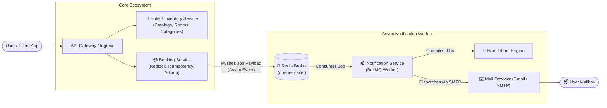
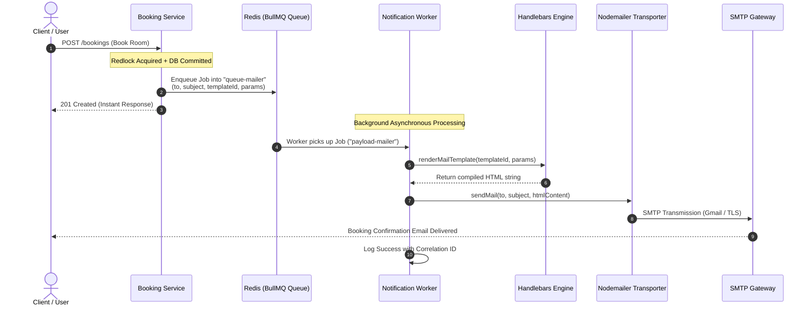
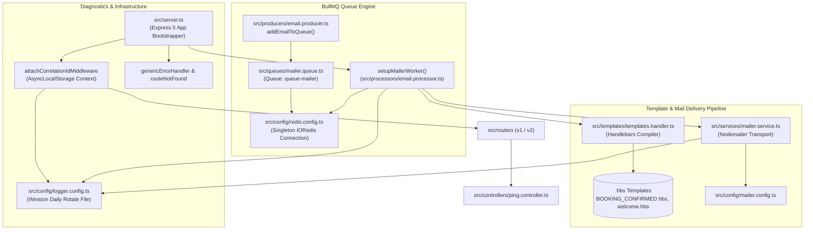

# 📬 Airbnb Notification Service (`Notification-Service-AirBnb`)

[](https://nodejs.org/)
[](https://www.typescriptlang.org/)
[](https://expressjs.com/)
[](https://redis.io/)
[](https://bullmq.io/)
[](https://handlebarsjs.com/)
[](https://github.com/winstonjs/winston)
[](https://zod.dev/)

A high-performance, asynchronous, event-driven notification microservice engineered as a core subsystem of the **Airbnb Clone Distributed Backend Architecture**. Built with **Node.js**, **Express 5**, **TypeScript**, **Redis**, and **BullMQ**, this service provides non-blocking, reliable email communications using **Nodemailer** and compiled **Handlebars** templates, backed by distributed tracing and rotating persistent logging.

---

## 📑 Table of Contents

- [1. Prerequisites](#1-prerequisites)
- [2. Getting Started: Clone & Installation](#2-getting-started-clone--installation)
  - [Step 1: Clone the Repository](#step-1-clone-the-repository)
  - [Step 2: Install Dependencies](#step-2-install-dependencies)
  - [Step 3: Configure Environment Variables](#step-3-configure-environment-variables)
  - [Step 4: Launch Redis](#step-4-launch-redis)
  - [Step 5: Run the Service](#step-5-run-the-service)
  - [Step 6: Verify Health](#step-6-verify-health)
- [3. System Architecture](#3-system-architecture)
  - [Microservices Ecosystem Context](#microservices-ecosystem-context)
  - [End-to-End Event-Driven Flow](#end-to-end-event-driven-flow)
  - [Internal Component Architecture](#internal-component-architecture)
  - [Job Payload Contract (`NotificationDto`)](#job-payload-contract-notificationdto)
- [4. Project & Directory Structure](#4-project--directory-structure)
- [5. API Endpoints & Usage](#5-api-endpoints--usage)
  - [Ping / Healthcheck Endpoint](#ping--healthcheck-endpoint)
  - [Standardized Response Envelopes](#standardized-response-envelopes)
- [6. Email Templates Showcase](#6-email-templates-showcase)
- [7. Important & Impressive Engineering Features](#7-important--impressive-engineering-features)
  - [⚡ Asynchronous Event-Driven Decoupling with BullMQ](#-asynchronous-event-driven-decoupling-with-bullmq)
  - [🔍 Distributed Tracing with Node.js AsyncLocalStorage](#-distributed-tracing-with-nodejs-asynclocalstorage)
  - [🔒 Singleton Redis Connection Management](#-singleton-redis-connection-management)
  - [📝 Production-Grade Rotating Logger (Winston + Daily Rotate)](#-production-grade-rotating-logger-winston--daily-rotate)
  - [🛡️ End-to-End Type Safety & Zod Validation](#️-end-to-end-type-safety--zod-validation)
  - [🧱 Robust Centralized Error Handling Hierarchy](#-robust-centralized-error-handling-hierarchy)
  - [🚀 Horizontal Scalability](#-horizontal-scalability)
- [8. Testing the Notification Queue](#8-testing-the-notification-queue)
- [9. Available Scripts](#9-available-scripts)
- [10. Troubleshooting](#10-troubleshooting)

---

## 1. Prerequisites

Before installing and launching the Notification Service, ensure your environment meets the following specifications:

- **Node.js**: v18.x, v20.x, or v22.x LTS installed ([Download Node.js](https://nodejs.org/))
- **npm**: v9.x or higher (packaged with Node.js)
- **Redis Server**: v6.0 or higher running locally or in Docker ([Download Redis](https://redis.io/) or use Docker)
- **SMTP Account**: A valid email account configured for SMTP dispatch (e.g., Google Gmail with an [App Password](https://support.google.com/accounts/answer/185833), Mailtrap, or SendGrid)

---

## 2. Getting Started: Clone & Installation

### Step 1: Clone the Repository

Clone the project from GitHub and navigate to the project directory:

```bash
git clone https://github.com/prajjwalmathur90/Notification-Service-AirBnb.git
cd Notification-Service-AirBnb
```

---

### Step 2: Install Dependencies

Install all production and development dependencies via `npm`:

```bash
npm install
```

This installs:
- Core runtime: `express` (v5), `bullmq`, `ioredis`, `nodemailer`, `handlebars`, `zod`, `uuid`, `dotenv`
- Logging utilities: `winston`, `winston-daily-rotate-file`
- Developer tooling: `typescript`, `ts-node`, `nodemon`, `@types/node`, `@types/express`

---

### Step 3: Configure Environment Variables

Create a `.env` file in the root directory by copying the provided template:

```bash
cp .env.example .env
```

Open `.env` and fill in the required configuration variables:

```env
# Application Server Port
PORT=3002

# Redis Configuration (Message Broker for BullMQ)
REDIS_HOST=localhost
REDIS_PORT=6379
REDIS_PASSWORD=redispassword

# Email / SMTP Configuration (Nodemailer)
MAIL_USER=your_email@gmail.com
MAIL_PASS=your_gmail_app_password
```

#### Detailed Variable Reference:

| Variable | Required | Default | Description |
|---|---|---|---|
| `PORT` | Optional | `3002` | Port on which the Express HTTP server listens. |
| `REDIS_HOST` | Optional | `localhost` | Hostname or IP of the Redis instance. |
| `REDIS_PORT` | Optional | `6379` | Port on which Redis accepts client connections. |
| `REDIS_PASSWORD`| Optional | `redispassword` | Authentication password for Redis (leave blank if passwordless). |
| `MAIL_USER` | **Required** | - | Sending email address used by the Nodemailer SMTP transporter. |
| `MAIL_PASS` | **Required** | - | App-specific password or SMTP password for the email provider. |

> [!TIP]
> **Gmail Setup Note**: If using Gmail, you cannot use your raw Google account password. You must enable **2-Step Verification** on your Google Account, navigate to **Security > App Passwords**, generate a 16-character app password for "Mail", and paste that into `MAIL_PASS`.

---

### Step 4: Launch Redis

BullMQ requires an active Redis instance. If you have Docker installed, spin up a lightweight Redis container with password authentication:

```bash
docker run -d \
  --name airbnb-redis \
  -p 6379:6379 \
  redis:alpine redis-server --requirepass "redispassword"
```

To verify Redis is responding:

```bash
docker exec -it airbnb-redis redis-cli -a redispassword ping
# Output: PONG
```

---

### Step 5: Run the Service

You can run the application in development mode with hot-reloading or directly with `ts-node`:

#### Development Mode (with Nodemon):
```bash
npm run dev
```

#### Direct Execution Mode:
```bash
npm start
```

Upon successful startup, the console displays:
```log
{"level":"info","message":"Server is running on http://localhost:3002","timestamp":"10-12-2026 14:00:00","correlationId":"unknown-error-while-creating-correlation-id","data":{}}
Mailer worker has been initialized
```

---

### Step 6: Verify Health

Send a GET request to the ping endpoint to verify that the HTTP server, routing, and middlewares are operational:

```bash
curl http://localhost:3002/api/v1/ping
```

**Response:**
```json
{
  "success": true,
  "data": "^_^",
  "message": "Pong!"
}
```

---

## 3. System Architecture

### Microservices Ecosystem Context

The Airbnb backend clone is partitioned into dedicated microservices, establishing strict separation of concerns, high throughput, and independent scalability:



1. **Hotel / Inventory Service (`AirBnb`)**: Manages the room catalogue, pricing, and availability models via MariaDB and Prisma.
2. **Booking Service (`Booking-Service`)**: Secures transactions using distributed locking (**Redlock**) and **Idempotency Keys** to eliminate race conditions and double-bookings. Once a booking succeeds, it enqueues a message to Redis without waiting for email delivery.
3. **Notification Service (`Notification-Service-AirBnb`)**: Listens to the `queue-mailer` queue, consumes notification events, compiles rich HTML templates, and delivers emails asynchronously.

---

### End-to-End Event-Driven Flow

The complete execution sequence when a booking transaction triggers a confirmation email:



---

### Internal Component Architecture

Inside the Notification Service codebase, responsibilities are partitioned into clean, cohesive layers:



---

### Job Payload Contract (`NotificationDto`)

Every job pushed into the `queue-mailer` queue adheres to a strict contract enforced by **Zod** in [`src/dtos/notification.dto.ts`](file:///c:/Users/pra90/Documents/Backend/AirBnb/Notfication-Service/src/dtos/notification.dto.ts):

```typescript
export const notificationSchema = z.object({
  to: z.string(),                            // Recipient email address
  subject: z.string(),                       // Email subject line
  templateId: z.string(),                    // Name of the .hbs template file
  params: z.record(z.string(), z.any()),     // Dynamic data injected into template
});

export type NotificationDto = z.infer<typeof notificationSchema>;
```

#### Example Job Payload:
```json
{
  "to": "guest@example.com",
  "subject": "Booking Confirmed! - Airbnb",
  "templateId": "BOOKING_CONFIRMED",
  "params": {
    "name": "Jane Doe",
    "orderId": "BK-98421-2026"
  }
}
```

---

## 4. Project & Directory Structure

```
Notification-Service-AirBnb/
├── logs/                                    # Auto-created rotating log directory
│   ├── .audit.json                          # Winston daily rotation audit trail
│   └── YYYY-MM-DD-app.log                   # Structured daily JSON logs
├── src/
│   ├── config/                              # Centralized configuration modules
│   │   ├── index.ts                         # Environment variable loader & typed config
│   │   ├── logger.config.ts                 # Winston logger with daily rotate & JSON format
│   │   ├── mailer.config.ts                 # Nodemailer SMTP transporter setup
│   │   └── redis.config.ts                  # Singleton IORedis connection factory
│   ├── controllers/                         # HTTP Route controllers
│   │   └── ping.controller.ts               # Healthcheck & ping controller
│   ├── dtos/                                # Data Transfer Objects & Zod Schemas
│   │   ├── notification.dto.ts              # Queue payload validation schema & type
│   │   └── ping.dto.ts                      # Ping request payload schema
│   ├── middlewares/                         # Express request middlewares
│   │   ├── correlation.middleware.ts        # AsyncLocalStorage correlation ID injector
│   │   ├── error.middleware.ts              # Global centralized error handler
│   │   ├── route-not-found.middleware.ts    # Fallback 404 handler
│   │   └── validate.ts                      # Generic Zod request body validation middleware
│   ├── processors/                          # BullMQ Worker job processors
│   │   └── email.processor.ts               # Worker consuming 'queue-mailer' jobs
│   ├── producers/                           # BullMQ Queue job dispatchers
│   │   └── email.producer.ts                # Helper to push notification jobs onto queue
│   ├── queues/                              # BullMQ Queue declarations
│   │   └── mailer.queue.ts                  # 'queue-mailer' Queue instance
│   ├── routers/                             # Versioned API route definitions
│   │   ├── v1/                              # API v1 routes
│   │   │   ├── index.router.ts              # Aggregated v1 router
│   │   │   └── ping.router.ts               # /api/v1/ping router
│   │   └── v2/                              # API v2 routes
│   │       └── index.router.ts              # Extensible v2 router placeholder
│   ├── services/                            # Core service layer
│   │   └── mailer.service.ts                # Transporter wrapper for sending emails
│   ├── templates/                           # Email presentation layer
│   │   ├── mailer/                          # Handlebars HTML email templates
│   │   │   ├── BOOKING_CONFIRMED.hbs        # Responsive Booking Confirmation email
│   │   │   └── welcome.hbs                  # Responsive User Welcome onboarding email
│   │   └── templates.handler.ts             # Handlebars compilation & file reader helper
│   ├── utils/                               # Shared utilities
│   │   ├── errors/
│   │   │   └── app.error.ts                 # Custom AppError class & factory functions
│   │   ├── helpers/
│   │   │   └── request.helpers.ts           # Node.js AsyncLocalStorage store & getters
│   │   └── responses/
│   │       └── app.response.ts              # Standardized API response wrappers
│   └── server.ts                            # Express application entrypoint & worker bootstrapper
├── .env.example                             # Environment variable template
├── package.json                             # Dependencies, scripts, and package metadata
├── report.md                                # Airbnb Clone system architecture report
├── tsconfig.json                            # TypeScript compiler configuration (NodeNext)
└── README.md                                # Comprehensive project documentation
```

---

## 5. API Endpoints & Usage

### Ping / Healthcheck Endpoint

Verifies the HTTP server is alive and checks correlation ID propagation.

- **URL**: `/api/v1/ping`
- **Method**: `GET`
- **Headers (Optional)**:
  - `x-correlation-id`: Unique client trace identifier (generated automatically if omitted)

#### Sample Request:
```bash
curl -X GET http://localhost:3002/api/v1/ping
```

#### Sample Response (`200 OK`):
```json
{
  "success": true,
  "data": "^_^",
  "message": "Pong!"
}
```

---

### Standardized Response Envelopes

The service enforces a unified response contract across all endpoints:

#### Successful Response Envelope:
```json
{
  "success": true,
  "data": { ... },
  "message": "Human-readable status message"
}
```

#### Error Response Envelope:
```json
{
  "success": false,
  "message": "Validation Failed",
  "details": [
    {
      "code": "invalid_type",
      "expected": "string",
      "received": "undefined",
      "path": ["to"],
      "message": "Required"
    }
  ]
}
```

---

## 6. Email Templates Showcase

All emails are designed with modern, responsive HTML layouts rendered using **Handlebars** (`.hbs`):

### 1. Booking Confirmation (`BOOKING_CONFIRMED.hbs`)
- **Trigger**: Emitted when a guest secures a room booking in the Booking Service.
- **Parameters**:
  - `{{name}}`: Customer's first/full name
  - `{{orderId}}`: Unique alphanumeric booking reference ID
- **Design Highlights**:
  - Emerald green theme (`#10b981` / `#059669`) with checkmark badge
  - Highlighted order ID card with uppercase tracking labels
  - Direct call-to-action button linking to the guest's booking dashboard
  - Mobile-responsive layout container (600px standard viewport)

### 2. Welcome Onboarding (`welcome.hbs`)
- **Trigger**: Emitted upon new guest or host registration.
- **Parameters**:
  - `{{name}}`: Newly registered user's name
  - `{{appName}}`: Platform application brand name (e.g. `Airbnb`)
- **Design Highlights**:
  - Modern indigo aesthetic (`#6366f1` / `#4f46e5`)
  - Friendly onboarding greeting and prompt to explore listings
  - Clean typography using system sans-serif font stack

---

## 7. Important & Impressive Engineering Features

### ⚡ Asynchronous Event-Driven Decoupling with BullMQ
- **Zero Request Latency Penalty**: Sending emails via external SMTP servers introduces network latencies ranging between 500ms to 3,000ms. By offloading this task to **BullMQ** and **Redis**, upstream services (like the Booking Service) complete transactions instantly and return sub-100ms responses to guests.
- **Resilient Worker Lifecycle**: The BullMQ worker (`email.processor.ts`) implements robust event listeners (`completed`, `failed`) and job validation, ensuring failed jobs are tracked and can be re-queued without losing messages.

---

### 🔍 Distributed Tracing with Node.js AsyncLocalStorage
- **Zero Prop-Drilling Tracing**: Traditional Node.js tracing requires passing `req` or `correlationId` into every internal function. This service uses Node's native `AsyncLocalStorage` in [`src/middlewares/correlation.middleware.ts`](file:///c:/Users/pra90/Documents/Backend/AirBnb/Notfication-Service/src/middlewares/correlation.middleware.ts).
- **Automatic Log Correlation**: The Winston logger automatically extracts `correlationId` using `getCorrelationId()` anywhere in the call stack. A single `x-correlation-id` can be traced from the initial HTTP request in the Booking Service all the way to disk logs in the Notification Service.

---

### 🔒 Singleton Redis Connection Management
- **Connection Leak Prevention**: Spawning multiple Redis connections per request exhausts socket limits. In [`src/config/redis.config.ts`](file:///c:/Users/pra90/Documents/Backend/AirBnb/Notfication-Service/src/config/redis.config.ts), a closure-based singleton pattern caches and reuses the single `ioredis` instance across all queue definitions and worker consumers.
- **BullMQ Optimization**: Specifically sets `maxRetriesPerRequest: null`, adhering to BullMQ's strict connection requirements to prevent command dropping during transient network disconnections.

---

### 📝 Production-Grade Rotating Logger (Winston + Daily Rotate)
- **Zero Disk Bloat**: High-volume notification services can rapidly fill up server storage. Using `winston-daily-rotate-file`, logs are automatically segmented into `logs/%DATE%-app.log` with a `20m` size ceiling and an automated `14d` retention window.
- **Structured JSON Logging**: Every log entry contains the level, timestamp, message, correlation ID, and metadata, making the logs directly ingestible by log aggregators like **Datadog**, **ELK (Elasticsearch/Logstash/Kibana)**, or **AWS CloudWatch**.

---

### 🛡️ End-to-End Type Safety & Zod Validation
- **Unified TypeScript + Zod Pipelines**: Schemas define runtime validation and compile-time TypeScript types simultaneously using `z.infer<typeof schema>`.
- **Reusable Validation Middleware**: The higher-order middleware `validate(schema)` in [`src/middlewares/validate.ts`](file:///c:/Users/pra90/Documents/Backend/AirBnb/Notfication-Service/src/middlewares/validate.ts) inspects JSON payloads, strips unexpected properties, and returns granular 400 Bad Request error breakdowns on schema mismatches.

---

### 🧱 Robust Centralized Error Handling Hierarchy
- **Standardized `AppError` Hierarchy**: Custom error class with dedicated convenience helpers (`badRequest`, `unauthorized`, `forbidden`, `notFound`, `conflict`, `internalServerError`) eliminating boilerplate `throw new Error(...)`.
- **Express 5 Native Async Support**: Compatible with Express 5's enhanced promise resolution, catching unhandled async rejections cleanly inside `genericErrorHandler`.

---

### 🚀 Horizontal Scalability
- **Stateless Consumer Nodes**: Because all queue states reside in Redis, the Notification Service is completely stateless. Multiple instances of this service can be deployed across a cluster or Kubernetes Pods; BullMQ automatically load balances incoming jobs across available worker processes with zero race conditions.

---

## 8. Testing the Notification Queue

You can easily trigger a test email job through the built-in producer function:

### Quick Code Snippet (Scratch Test):
Create a file `test-email.ts`:

```typescript
import { addEmailToQueue } from "./src/producers/email.producer";

async function runTest() {
  await addEmailToQueue({
    to: "testuser@example.com",
    subject: "Booking Confirmed! - Airbnb Clone",
    templateId: "BOOKING_CONFIRMED",
    params: {
      name: "Alex Smith",
      orderId: "AB-2026-X992",
    },
  });

  console.log("Test email job successfully enqueued!");
}

runTest();
```

Run with `ts-node`:
```bash
npx ts-node test-email.ts
```

Inspect the logs in `logs/` to confirm execution:
```json
{"level":"info","message":"Email sent successfully to : testuser@example.com with subject : Booking Confirmed! - Airbnb Clone"}
```

---

## 9. Available Scripts

The project includes the following scripts defined in `package.json`:

| Command | Action |
|---|---|
| `npm run dev` | Starts the server in development mode using `nodemon` for auto-reloading on file changes. |
| `npm start` | Executes the server directly using `ts-node src/server.ts`. |

---

## 10. Troubleshooting

<details>
<summary><b>1. Redis Connection Error (ECONNREFUSED)</b></summary>

- **Symptom**: `Error: connect ECONNREFUSED 127.0.0.1:6379`
- **Solution**: Ensure your Redis daemon or Docker container is running. Verify `REDIS_HOST` and `REDIS_PORT` in your `.env` match your Redis instance.
</details>

<details>
<summary><b>2. Nodemailer Invalid Login / Username and Password Not Accepted</b></summary>

- **Symptom**: `Error: Invalid login: 535-5.7.8 Username and Password not accepted`
- **Solution**: For Gmail, do not use your standard Google password. Go to your Google Account > Security > App Passwords, generate an App Password, and set it as `MAIL_PASS`.
</details>

<details>
<summary><b>3. Template Not Found Error</b></summary>

- **Symptom**: `AppError: Template not found!`
- **Solution**: Ensure the `templateId` specified in the job payload matches a `.hbs` file in `src/templates/mailer/` (e.g. use `BOOKING_CONFIRMED` for `BOOKING_CONFIRMED.hbs`).
</details>

---

## 📜 License

This project is licensed under the **ISC License**.
